<picture><source media="(prefers-color-scheme: dark)" srcset="assets/hero-dark.svg"></picture>

<picture><source media="(prefers-color-scheme: dark)" srcset="assets/about-dark.svg"></picture>

<picture><source media="(prefers-color-scheme: dark)" srcset="assets/stack-dark.svg"></picture>

<a href="https://github.com/fiangg20/superbase"><picture><source media="(prefers-color-scheme: dark)" srcset="assets/project-superbase-dark.svg"></picture></a>&nbsp;<a href="https://github.com/fiangg20/wavelength"><picture><source media="(prefers-color-scheme: dark)" srcset="assets/project-wavelength-dark.svg"></picture></a>

<a href="https://github.com/fiangg20/expressivelauncher"><picture><source media="(prefers-color-scheme: dark)" srcset="assets/project-expressivelauncher-dark.svg"></picture></a>&nbsp;<a href="https://github.com/fiangg20/FyanHub"><picture><source media="(prefers-color-scheme: dark)" srcset="assets/project-fyanhub-dark.svg"></picture></a>

<picture><source media="(prefers-color-scheme: dark)" srcset="assets/stats-dark.svg"></picture>

<picture><source media="(prefers-color-scheme: dark)" srcset="assets/streak-dark.svg"></picture>

<picture><source media="(prefers-color-scheme: dark)" srcset="assets/wave-dark.svg"></picture>

<a href="https://saweria.co/bases"><picture><source media="(prefers-color-scheme: dark)" srcset="assets/button-1-dark.svg"></picture></a>&nbsp;&nbsp;<a href="https://tiktok.com/@bases.devs"><picture><source media="(prefers-color-scheme: dark)" srcset="assets/button-2-dark.svg"></picture></a>

