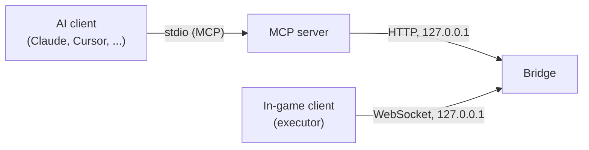

<div align="center">


[](https://github.com/fiangg20/superbase)

<br/>


</div>

---

## 👋 About Me

```lua
--!strict
local Bases = {
	location = "Indonesia 🇮🇩",
	language = "Luau",
	building = "Superbase, an MCP server that lets AI debug live Roblox games",
	focus    = { "Luau", "MCP servers", "developer tools", "debugging" },
	motto    = "Reaching the base before the stack overflows.",
}

return Bases
```

---

## 🛠️ Tech Stack

<div align="center">


</div>

---

## ✨ Featured Project

<div align="center">

<a href="https://github.com/fiangg20/superbase">
  
</a>

### [Superbase](https://github.com/fiangg20/superbase)

**Let an AI assistant debug your live Roblox game.**

<a href="https://github.com/fiangg20/superbase">
  
</a>

</div>

Superbase is a local [Model Context Protocol](https://modelcontextprotocol.io) server that connects AI assistants to a running Roblox session. The AI can read the console and script errors, inspect the instance tree, read scripts and run Lua, and it always knows whether Roblox is actually connected.

- ⚡ **Zero configuration**: no token, no account, no copy and paste
- 🔌 **Connection aware**: every tool result starts with a live status line
- 🧰 **11 tools**: logs, errors, inspection, scripts, properties and code execution
- 🤝 **Works with any MCP client**: Claude Desktop, Claude Code, Cursor, Windsurf, VS Code, Codex CLI and more
- 🔒 **Local only**: everything listens on `127.0.0.1`



```bash
git clone https://github.com/fiangg20/superbase.git
cd superbase
npm install
npm start
```

> Built for debugging your own games. Only connect AI clients you trust.

---

## 📊 GitHub Stats

<div align="center">


<br/>


</div>

---

## 📫 Let's Connect

<div align="center">

[](https://youtube.com/@fian_gg)
[](mailto:fiangaming005@gmail.com)

<br/>

*⭐ If Superbase saves you a debugging session, a star on the repo goes a long way!*


</div>
